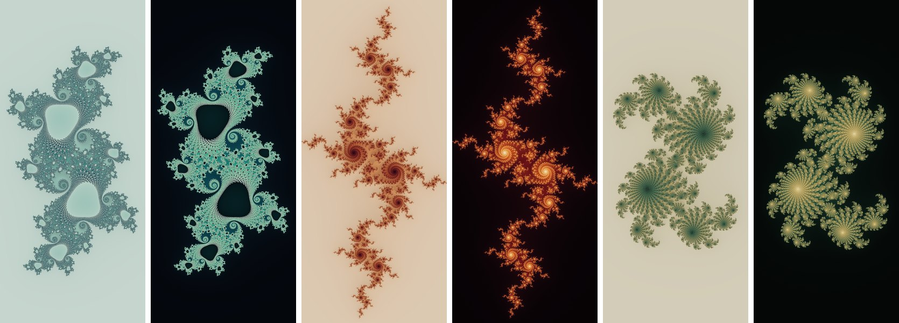

# PROJ-julia-wallpaper-android


Application Android qui change le fond d'écran à chaque mise en veille (bouton marche/arrêt) : une nouvelle fractale de l'**ensemble de Julia** calculée sur le téléphone, à la taille exacte de l'écran, avec une version **mode clair** et une version **mode sombre**.

Version Android de [PROJ-julia-wallpaper-linux](https://github.com/LouisBrusset/PROJ-julia-wallpaper-linux) (même moteur, porté en Java).



## Fonctionnalités

- **Une fractale différente à chaque extinction de l'écran.** La suivante est toujours calculée d'avance : le changement est instantané.
- **Mode clair / mode sombre** : chaque fractale existe en deux versions, et la bonne s'applique automatiquement quand le thème du téléphone change.
- **Accueil, verrouillage ou les deux**, au choix.
- **Favoris** : un appui sur « ♥ Favori » garde la fractale affichée. Ensuite, un appui sur un favori permet de l'appliquer, de l'enregistrer dans la galerie (`Images/Julia`) ou de la supprimer.
- **Interrupteur** pour activer ou couper le service.
- **Taille d'écran détectée automatiquement**, avec un cadrage adapté au portrait.
- **Fractales choisies pour être belles** : paramètres près du bord de l'ensemble de Mandelbrot, cinq thèmes de couleurs.

## Installation

### Avec l'APK

1. Téléchargez `julia-wallpaper.apk` (page [Releases](../../releases) ou fichier fourni).
2. Ouvrez-le sur le téléphone. Android demande d'autoriser l'installation depuis cette source (navigateur ou gestionnaire de fichiers) : acceptez pour cette application.
3. Ouvrez **Fonds Julia** et activez **« Changer à chaque mise en veille »**. La première fractale est calculée et appliquée en quelques secondes.

L'APK n'est pas publié sur le Play Store. Il est signé avec une clé personnelle, donc Play Protect peut afficher un avertissement « application inconnue ».

Configuration requise : Android 11 ou plus récent. Conçu pour un Samsung Galaxy A52s 5G (1080 × 2400) sous ROM AOSP (LineageOS, /e/OS).

### Compiler soi-même

Pas besoin d'Android Studio ni de Gradle : un script compile l'APK avec les outils de base du SDK.

Debian / Ubuntu :

```bash
sudo apt install openjdk-17-jdk aapt apksigner zipalign dalvik-exchange
git clone https://github.com/LouisBrusset/PROJ-julia-wallpaper-android.git
cd PROJ-julia-wallpaper-android
ANDROID_JAR=/chemin/vers/android-sdk/platforms/android-34/android.jar ./build.sh
# -> build/julia-wallpaper.apk
```

Avec le SDK Android officiel, indiquez les outils de `build-tools` : `AAPT2=…/aapt2 ZIPALIGN=…/zipalign APKSIGNER=…/apksigner`, et `DX=…/d8` en adaptant la ligne `dx` du script.

**Signature.** Le script crée une clé `debug.keystore` si `KEYSTORE` n'est pas fourni. Pour installer une mise à jour par-dessus une version existante, il faut **la même clé** que la première fois : conservez-la (elle est exclue de git).

## Utilisation

| Élément | Effet |
|---|---|
| Aperçu | la fractale actuelle, dans la variante du thème en cours |
| **Suivante** | passe tout de suite à une nouvelle fractale |
| **♥ Favori** | garde la fractale actuelle |
| Interrupteur | active ou coupe le changement automatique |
| Appliquer sur | accueil + verrouillage, accueil seul ou verrouillage seul |
| Appui sur un favori | appliquer, enregistrer dans Images/Julia, supprimer |

## Fonctionnement

- **`JuliaService`** est un service de premier plan qui tourne dans son propre processus (`:wall`). Android ne transmet l'événement « écran éteint » qu'à un composant en vie, d'où ce service. Il n'utilise pas d'AndroidX ni de Kotlin, reste en sommeil entre deux événements et n'affiche pas de notification tant que l'appli n'a pas la permission de notifier.
  - **Écran éteint** : il applique la fractale suivante, déjà prête, avec `WallpaperManager.setStream`. C'est le système qui décode l'image, pas l'appli.
  - **Ensuite**, il calcule la nouvelle suivante en priorité basse, pendant que l'écran est éteint.
  - **Changement de thème** clair/sombre : il réapplique la bonne variante.
- **`Renderer`** est le moteur, en Java pur.
  - Il tire 10 paramètres `c` dans une « famille » au hasard et note chacun sur un aperçu (densité de détails, remplissage, format). Puis il cadre le meilleur selon son axe principal, tourné pour suivre la hauteur de l'écran.
  - Il calcule la fractale une seule fois en multi-thread et la colore deux fois (jour et nuit), avec des dégradés OKLab, un anti-crénelage adaptatif et un tramage.
  - **Mémoire** : 4 octets par pixel pendant le calcul, environ 10 Mo pour 1080 × 2400, libérés juste après. Les images couleur ne sont jamais entièrement en mémoire : elles sont compressées en PNG bande par bande, au fil du calcul.
- **`MainActivity`** est l'interface, dans un processus séparé, avec uniquement les widgets du système. Les vignettes sont décodées en sous-échantillonné (RGB 565).

Fichiers de l'appli : `files/walls/` (fond actuel et suivant), `files/favs/` (favoris), `settings.properties` (réglages) et `state.properties` (état du service).

## Remarques

- Sous Android 12 et plus, les couleurs du système (Material You) suivent le fond d'écran : elles changent donc avec chaque fractale, sauf si une palette fixe est choisie dans les réglages.
- La forme de l'icône (cercle, carré…) dépend du lanceur. Pour une icône carrée, choisissez la forme carrée dans les réglages du lanceur s'il le propose.
- Sur les surcouches qui ferment agressivement les applis en arrière-plan, excluez **Fonds Julia** de l'optimisation de batterie.

## Licence

[MIT](LICENSE)
